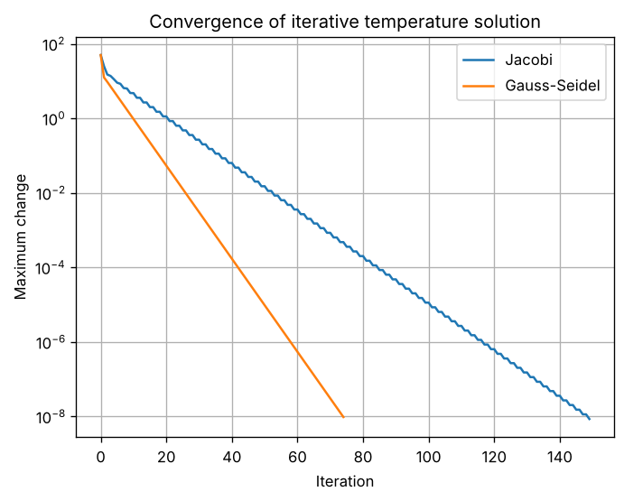
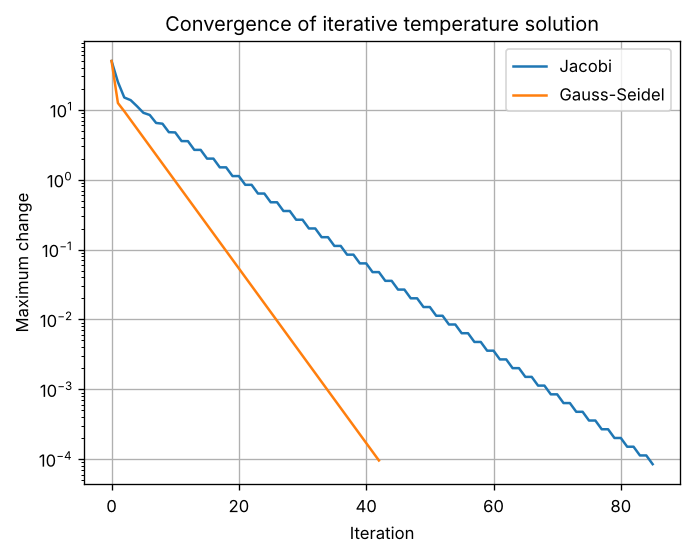
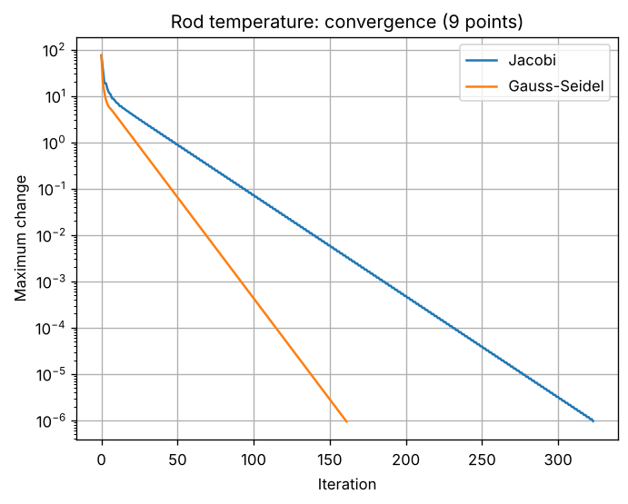

# Task 8: Iterative Methods for Linear Systems

**Course:** BIT 2118 Scientific Computing  
**Student:** Michael Asilwa (Admission No: BSCCS/2024/56330, GitHub: xxplosi)  
**Files:** `code/Task_08_iterative_linear.py` (given program), `code/Task_08_iterative_linear_param_change.py` (changed parameter), `code/Task_08_modified.py` (my real-world case)

## 1. Inputs and mathematical operation

- **Input data:** a 5x5 tridiagonal matrix (2 on the diagonal, -1 on the neighbouring diagonals) modelling five interior points of a rod, and b = [100, 0, 0, 0, 20] (left boundary 100 C, right boundary 20 C). Tolerance is 1e-8.
- **Mathematical operations:** Jacobi and Gauss-Seidel iteration. Each iteration recomputes every unknown from the current estimates of its neighbours until the maximum change is below the tolerance. The direct solution is used as a reference.

## 2. Original program and output

Run with `python code/Task_08_iterative_linear.py`.

```text
Jacobi temperatures: [86.66666665 73.33333331 59.99999997 46.66666664 33.33333332]
Gauss-Seidel temperatures: [86.66666665 73.3333333  59.99999997 46.66666665 33.33333332]
Direct solution: [86.66666667 73.33333333 60.         46.66666667 33.33333333]
Jacobi iterations: 150
Gauss-Seidel iterations: 75
```



## 3. Changing a parameter

**What I changed:** Loosened the stopping tolerance in both methods from 1e-8 to 1e-4.

```python
def jacobi(A, b, tol=1e-4, max_iter=500):        # was 1e-8
def gauss_seidel(A, b, tol=1e-4, max_iter=500):  # was 1e-8
```

**Output after the change** (`code/Task_08_iterative_linear_param_change.py`):

```text
Jacobi temperatures: [86.66649696 73.33307878 59.99966059 46.66641211 33.33316363]
Gauss-Seidel temperatures: [86.66647496 73.33304578 59.99971244 46.666451   33.3332255 ]
Direct solution: [86.66666667 73.33333333 60.         46.66666667 33.33333333]
Jacobi iterations: 86
Gauss-Seidel iterations: 43
```



**How the result changed and why:** With the looser tolerance the number of iterations dropped (Jacobi from 150 to 86, Gauss-Seidel from 75 to 43), but the answers became less accurate: for example the first Jacobi temperature is 86.66650 instead of 86.66667 (error about 2e-4). A looser tolerance saves work and costs accuracy. Gauss-Seidel needed about half as many iterations as Jacobi in both cases.

## 4. Meaning of the output

Both methods converge to the direct solution [86.67, 73.33, 60.00, 46.67, 33.33] C: the temperature falls evenly from the hot end (100 C) to the cold end (20 C), by about 13.33 C per step. On the semi-log graph both curves are straight lines going down, which means the error shrinks by a constant factor each iteration. The Gauss-Seidel line is steeper, so it converges about twice as fast (75 versus 150 iterations) because it uses newly computed values immediately.

## 5. Modified real-world case: Steady-state temperature along a metal rod with 9 interior points

### Assumptions and input data

- Left end held at 150 C and right end at 30 C, steady state, equally spaced points, nine unknown temperatures.
- Tolerance 1e-6 for both Jacobi and Gauss-Seidel.

### Program (`code/Task_08_modified.py`)

```python
"""Task 8 (modified): Temperature along a metal rod with 9 interior points.
Assumption: left end held at 150 C, right end at 30 C, steady state, equal spacing.
Compare Jacobi and Gauss-Seidel convergence for a bigger system."""
import numpy as np
import matplotlib.pyplot as plt

n = 9
A = 2*np.eye(n) - np.eye(n, k=1) - np.eye(n, k=-1)
b = np.zeros(n); b[0] = 150.0; b[-1] = 30.0

def jacobi(A, b, tol=1e-6, max_iter=5000):
    D = np.diag(A); R = A - np.diagflat(D)
    x = np.zeros_like(b); errs = []
    for _ in range(max_iter):
        xn = (b - R @ x) / D
        e = np.linalg.norm(xn - x, np.inf); errs.append(e); x = xn
        if e < tol: break
    return x, errs

def gauss_seidel(A, b, tol=1e-6, max_iter=5000):
    x = np.zeros_like(b); errs = []
    for _ in range(max_iter):
        old = x.copy()
        for i in range(len(b)):
            x[i] = (b[i] - A[i, :i] @ x[:i] - A[i, i+1:] @ old[i+1:]) / A[i, i]
        e = np.linalg.norm(x - old, np.inf); errs.append(e)
        if e < tol: break
    return x, errs

xj, ej = jacobi(A, b)
xg, eg = gauss_seidel(A, b)
exact = np.linalg.solve(A, b)

print("Exact temperatures:", np.round(exact, 3))
print(f"Jacobi iterations: {len(ej)}, max error vs exact: {np.max(np.abs(xj-exact)):.2e}")
print(f"Gauss-Seidel iterations: {len(eg)}, max error vs exact: {np.max(np.abs(xg-exact)):.2e}")

plt.semilogy(ej, label="Jacobi"); plt.semilogy(eg, label="Gauss-Seidel")
plt.xlabel("Iteration"); plt.ylabel("Maximum change")
plt.title("Rod temperature: convergence (9 points)")
plt.legend(); plt.grid(True); plt.show()
```

### Output

```text
Exact temperatures: [138. 126. 114. 102.  90.  78.  66.  54.  42.]
Jacobi iterations: 324, max error vs exact: 1.01e-05
Gauss-Seidel iterations: 162, max error vs exact: 8.96e-06
```



### Interpretation

The exact solution is a straight line from 138 C down to 42 C, dropping by 12 C per point, as expected for steady-state conduction in a uniform rod. Jacobi needed 324 iterations and Gauss-Seidel 162, with final errors of about 1e-5. Compared with the 5-point rod (150 and 75 iterations at a tighter tolerance), the bigger system converges more slowly, which is why large grids need faster iterative methods. Gauss-Seidel again needs about half as many iterations.

---
*Note: numbers marked as timings (Tasks 3 and 7) depend on the computer and change slightly from run to run. All other results are reproducible with the fixed random seeds in the code.*
