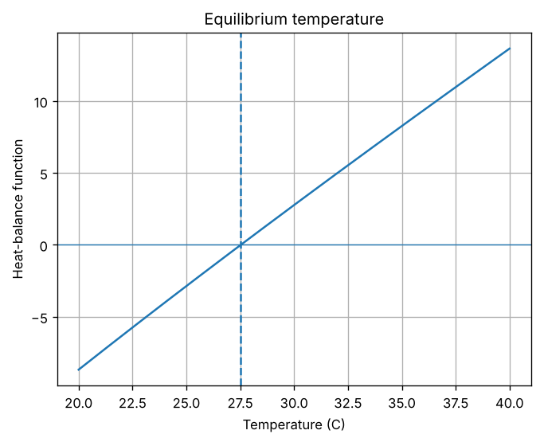
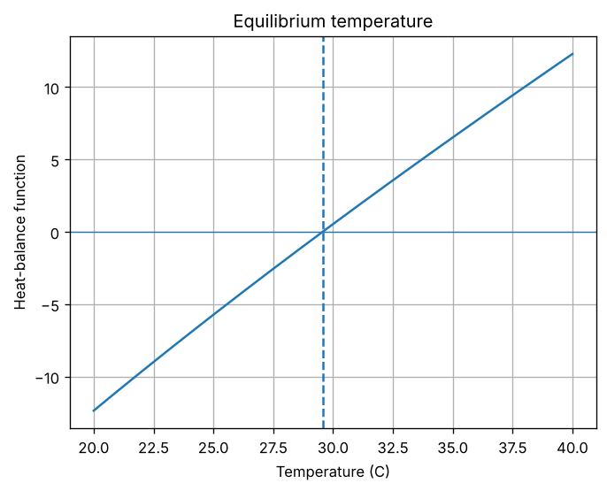
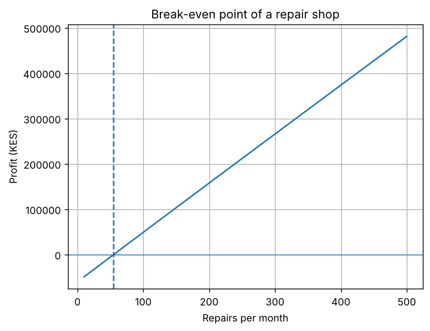

# Task 10: Root Finding: Bisection and Fixed-Point Methods

**Course:** BIT 2118 Scientific Computing  
**Student:** Michael Asilwa (Admission No: BSCCS/2024/56330, GitHub: xxplosi)  
**Files:** `code/Task_10_bisection_fixed_point.py` (given program), `code/Task_10_bisection_fixed_point_param_change.py` (changed parameter), `code/Task_10_modified.py` (my real-world case)

## 1. Inputs and mathematical operation

- **Input data:** the heat-balance function f(T) = T - 25 - 10 e^(-T/20), the bracket [20, 40] with a sign change, tolerance 1e-10, and the starting guess T = 30 for fixed-point iteration with g(T) = 25 + 10 e^(-T/20).
- **Mathematical operations:** bisection repeatedly halves the bracket keeping the half where f changes sign; fixed-point iteration repeats T_new = g(T) until the change is below 1e-10.

## 2. Original program and output

Run with `python code/Task_10_bisection_fixed_point.py`.

```text
Bisection equilibrium temperature: 27.525211 C
Fixed-point equilibrium temperature: 27.525211 C
Fixed-point iterations: 13
```



## 3. Changing a parameter

**What I changed:** Changed the coefficient 10 to 20 in both the function and the fixed-point form.

```python
return T - 25 - 20*np.exp(-T/20)   # was 10
return 25 + 20*np.exp(-T/20)       # was 10
```

**Output after the change** (`code/Task_10_bisection_fixed_point_param_change.py`):

```text
Bisection equilibrium temperature: 29.561521 C
Fixed-point equilibrium temperature: 29.561521 C
Fixed-point iterations: 17
```



**How the result changed and why:** The equilibrium temperature moved from 27.525 C to 29.562 C because the exponential term has a larger effect. Fixed-point iteration needed 17 iterations instead of 13, so it converged more slowly. Fixed-point iteration converges when |g'(T)| is below 1; here |g'(T)| = (c/20) e^(-T/20) is about 0.13 for c = 10 and about 0.23 for c = 20, and a larger value means slower convergence.

## 4. Meaning of the output

Both methods agree: the equilibrium temperature, where heat gain equals heat loss, is 27.525211 C. Fixed-point iteration reached it in 13 iterations. The graph shows the heat-balance function rising through zero, and the dashed vertical line marks the root at 27.525 C. Below that temperature the function is negative and above it the function is positive.

## 5. Modified real-world case: Break-even point of a phone-repair shop

### Assumptions and input data

- Revenue is KES 1,500 per repair. Monthly cost = KES 60,000 fixed + KES 400 per repair + 0.8 n^1.5 (extra staff and overtime cost that grows faster than volume).
- Break-even is where profit(n) = 0. Bisection is used on the bracket [10, 500], where profit changes sign.

### Program (`code/Task_10_modified.py`)

```python
"""Task 10 (modified): Break-even point of a phone-repair shop using bisection.
Assumption (KES per month): revenue = 1,500 per repair.
Cost = 60,000 fixed + 400 per repair + 0.8*n^1.5 (extra staff/overtime cost grows with volume).
Break-even is where profit(n) = revenue - cost = 0."""
import numpy as np
import matplotlib.pyplot as plt

def profit(n):
    revenue = 1500 * n
    cost = 60000 + 400 * n + 0.8 * n**1.5
    return revenue - cost

def bisection(f, a, b, tol=1e-6):
    assert f(a) * f(b) < 0, "Need a sign change"
    steps = 0
    while (b - a) / 2 > tol:
        m = (a + b) / 2
        if f(a) * f(m) <= 0: b = m
        else: a = m
        steps += 1
    return (a + b) / 2, steps

n_star, steps = bisection(profit, 10, 500)
print(f"Break-even repairs per month: {n_star:.3f}  (found in {steps} bisection steps)")
print(f"Round up to whole repairs: {int(np.ceil(n_star))}")
print(f"Profit at break-even: {profit(n_star):.6f} KES")
print(f"Profit at 200 repairs: {profit(200):,.0f} KES")

n = np.linspace(10, 500, 300)
plt.plot(n, profit(n)); plt.axhline(0, linewidth=0.8); plt.axvline(n_star, linestyle="--")
plt.xlabel("Repairs per month"); plt.ylabel("Profit (KES)")
plt.title("Break-even point of a repair shop"); plt.grid(True); plt.show()
```

### Output

```text
Break-even repairs per month: 54.841  (found in 28 bisection steps)
Round up to whole repairs: 55
Profit at break-even: 0.000711 KES
Profit at 200 repairs: 157,737 KES
```



### Interpretation

The shop breaks even at about 54.84 repairs per month, so it needs at least 55 whole repairs to avoid a loss. Bisection took 28 steps, consistent with log2(490 / 1e-6) which is about 29. At 200 repairs the profit is about KES 157,737. The graph crosses zero at the break-even point: negative profit to the left and positive profit to the right.

---
*Note: numbers marked as timings (Tasks 3 and 7) depend on the computer and change slightly from run to run. All other results are reproducible with the fixed random seeds in the code.*
