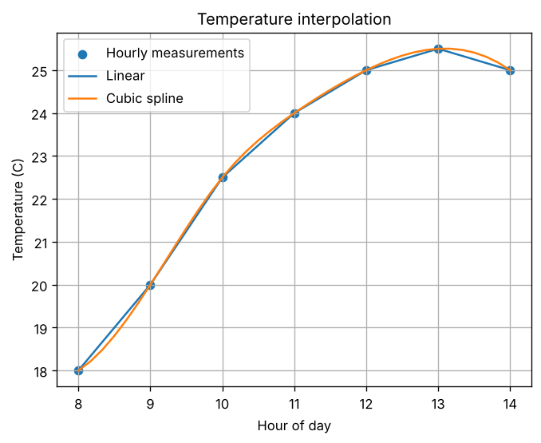
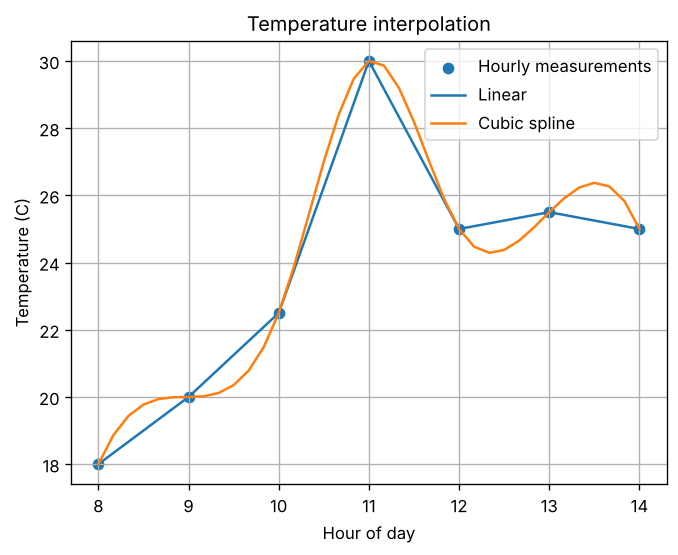
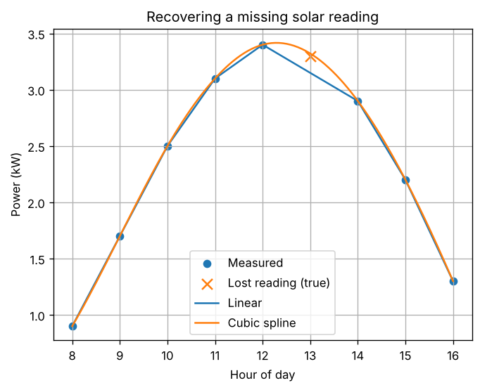

# Task 13: Interpolation

**Course:** BIT 2118 Scientific Computing  
**Student:** Michael Asilwa (Admission No: BSCCS/2024/56330, GitHub: xxplosi)  
**Files:** `code/Task_13_interpolation.py` (given program), `code/Task_13_interpolation_param_change.py` (changed parameter), `code/Task_13_modified.py` (my real-world case)

## 1. Inputs and mathematical operation

- **Input data:** hourly temperatures at hours 8 to 14: [18.0, 20.0, 22.5, 24.0, 25.0, 25.5, 25.0] C, and a target time of 10:30.
- **Mathematical operations:** linear interpolation (straight lines between neighbouring points) and a cubic spline (smooth piecewise cubic curve), evaluated every 10 minutes.

## 2. Original program and output

Run with `python code/Task_13_interpolation.py`.

```text
Linear estimate at 10:30: 23.25 C
Cubic estimate at 10:30: 23.36 C
```



## 3. Changing a parameter

**What I changed:** Changed the 11:00 reading from 24.0 C to 30.0 C (a sudden spike).

```python
temperature = np.array([18.0, 20.0, 22.5, 30.0, 25.0, 25.5, 25.0])   # 11:00 was 24.0
```

**Output after the change** (`code/Task_13_interpolation_param_change.py`):

```text
Linear estimate at 10:30: 26.25 C
Cubic estimate at 10:30: 27.01 C
```



**How the result changed and why:** The 10:30 estimates rose from 23.25 C (linear) and 23.36 C (cubic) to 26.25 C and 27.01 C. The graph shows that the cubic spline now overshoots: between 12:00 and 14:00 it dips to about 24.3 C and rises to about 26.4 C, although the measurements there are only 25.0, 25.5 and 25.0. Linear interpolation never goes outside the neighbouring values, while a cubic spline can oscillate after a sharp change.

## 4. Meaning of the output

At 10:30 the linear estimate is 23.25 C, which is simply the average of 22.5 and 24.0. The cubic spline gives 23.36 C because it also uses the curvature of the surrounding data (the temperature is rising but levelling off). On the graph both curves pass through every measured point; the spline is smooth while the linear curve has corners.

## 5. Modified real-world case: Recovering a missing solar-panel reading

### Assumptions and input data

- Hourly power output (kW) of a small solar panel from 08:00 to 16:00 (synthetic data).
- The 13:00 reading (true value 3.3 kW) is treated as lost and estimated from the other points, so the methods can be tested against a known answer.

### Program (`code/Task_13_modified.py`)

```python
"""Task 13 (modified): Estimating a missing solar-panel reading.
Assumption: hourly power output (kW) of a small solar panel, synthetic data.
The 13:00 reading is "lost"; we estimate it from the other hours and compare
with the true value (which we kept aside) to test the interpolation methods."""
import numpy as np
from scipy.interpolate import interp1d, CubicSpline
import matplotlib.pyplot as plt

hours = np.array([8, 9, 10, 11, 12, 13, 14, 15, 16], dtype=float)
power = np.array([0.9, 1.7, 2.5, 3.1, 3.4, 3.3, 2.9, 2.2, 1.3])

missing_hour, true_value = 13.0, 3.3
keep = hours != missing_hour

linear = interp1d(hours[keep], power[keep])
cubic = CubicSpline(hours[keep], power[keep])

print(f"True 13:00 reading        : {true_value:.3f} kW")
print(f"Linear estimate           : {float(linear(13.0)):.3f} kW  (error {abs(float(linear(13.0))-true_value):.3f})")
print(f"Cubic-spline estimate     : {float(cubic(13.0)):.3f} kW  (error {abs(float(cubic(13.0))-true_value):.3f})")
print(f"Cubic estimate at 10:30   : {float(cubic(10.5)):.3f} kW")

t = np.linspace(8, 16, 200)
plt.scatter(hours[keep], power[keep], label="Measured")
plt.scatter([13], [true_value], marker="x", s=80, label="Lost reading (true)")
plt.plot(t, linear(t), label="Linear"); plt.plot(t, cubic(t), label="Cubic spline")
plt.xlabel("Hour of day"); plt.ylabel("Power (kW)")
plt.title("Recovering a missing solar reading"); plt.legend(); plt.grid(True); plt.show()
```

### Output

```text
True 13:00 reading        : 3.300 kW
Linear estimate           : 3.150 kW  (error 0.150)
Cubic-spline estimate     : 3.322 kW  (error 0.022)
Cubic estimate at 10:30   : 2.832 kW
```



### Interpretation

The linear estimate of the lost 13:00 reading is 3.150 kW (error 0.150) and the cubic spline estimate is 3.322 kW (error 0.022). The spline is better here because solar output rises and falls in a smooth curve, and a straight line cuts below the peak. The spline also estimates 2.832 kW at 10:30. Holding back a known value is a simple way to check an interpolation method before trusting it on truly missing data.

---
*Note: numbers marked as timings (Tasks 3 and 7) depend on the computer and change slightly from run to run. All other results are reproducible with the fixed random seeds in the code.*
