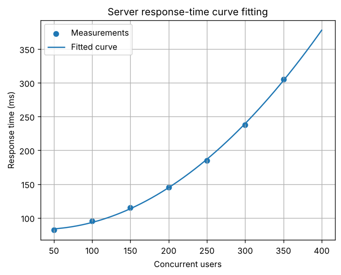
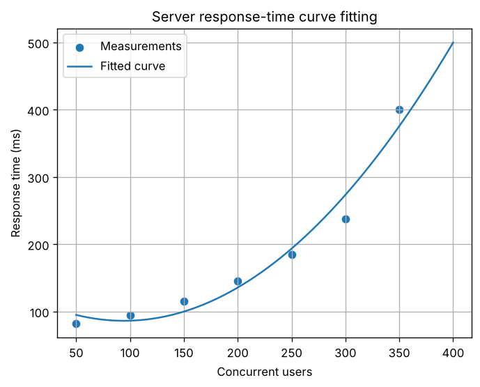
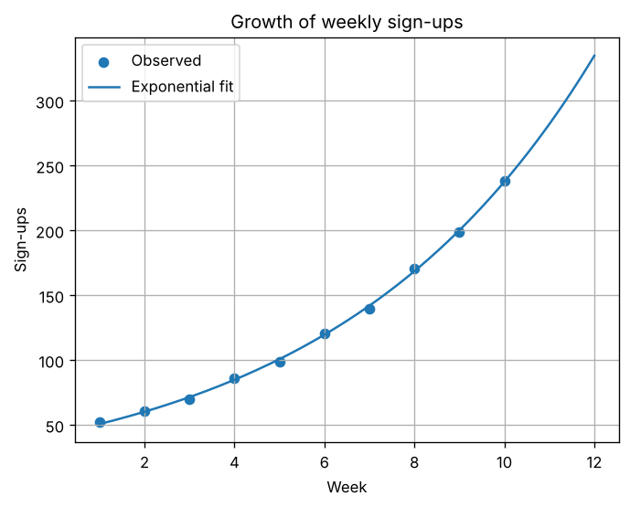

# Task 14: Curve Fitting and Approximation

**Course:** BIT 2118 Scientific Computing  
**Student:** Michael Asilwa (Admission No: BSCCS/2024/56330, GitHub: xxplosi)  
**Files:** `code/Task_14_curve_fitting.py` (given program), `code/Task_14_curve_fitting_param_change.py` (changed parameter), `code/Task_14_modified.py` (my real-world case)

## 1. Inputs and mathematical operation

- **Input data:** seven server measurements: users [50, 100, ..., 350] and response times [82, 95, 115, 145, 185, 238, 305] ms.
- **Mathematical operation:** least-squares fit of the quadratic model y = a x^2 + b x + c with `curve_fit`, which chooses a, b and c to minimise the sum of squared residuals; then RMSE and a prediction at 400 users.

## 2. Original program and output

Run with `python code/Task_14_curve_fitting.py`.

```text
Fitted model: y = 0.002167x^2 + -0.1345x + 85.00
RMSE: 1.55 ms
Predicted response at 400 users: 377.86 ms
```



## 3. Changing a parameter

**What I changed:** Changed the last response time from 305 ms to 400 ms (a sudden jump at 350 users).

```python
response_ms = np.array([82, 95, 115, 145, 185, 238, 400], dtype=float)   # last value was 305
```

**Output after the change** (`code/Task_14_curve_fitting_param_change.py`):

```text
Fitted model: y = 0.004429x^2 + -0.8357x + 125.71
RMSE: 18.83 ms
Predicted response at 400 users: 500.00 ms
```



**How the result changed and why:** The fitted curve changed to y = 0.004429x^2 - 0.8357x + 125.71, the RMSE jumped from 1.55 ms to 18.83 ms, and the prediction at 400 users rose from 377.86 ms to 500.00 ms. One changed measurement moved the whole curve. The much larger RMSE shows that a quadratic no longer describes the data well, so a different model (for example one with saturation) or a check of that measurement would be needed.

## 4. Meaning of the output

The fit is y = 0.002167x^2 - 0.1345x + 85.00 with an RMSE of 1.55 ms, so the model follows the measurements closely (response times range from 82 to 305 ms). The curve bends upward: each extra user adds more delay as the server gets busier. The predicted 377.86 ms at 400 users is an extrapolation beyond the data, so it is less reliable than predictions inside 50 to 350 users.

## 5. Modified real-world case: Growth curve of weekly app sign-ups

### Assumptions and input data

- Ten weeks of synthetic weekly sign-ups: 52, 61, 70, 86, 99, 121, 140, 171, 199, 238.
- Model: y = a exp(b week), an exponential growth curve. Fit parameters with `curve_fit`, then forecast week 12.

### Program (`code/Task_14_modified.py`)

```python
"""Task 14 (modified): Growth curve of weekly app sign-ups.
Assumption: 10 weeks of synthetic sign-up counts that grow roughly exponentially.
Fit y = a*exp(b*week) and use it to forecast week 12."""
import numpy as np
from scipy.optimize import curve_fit
import matplotlib.pyplot as plt

weeks = np.arange(1, 11, dtype=float)
signups = np.array([52, 61, 70, 86, 99, 121, 140, 171, 199, 238], dtype=float)

def model(x, a, b):
    return a * np.exp(b * x)

(a, b), cov = curve_fit(model, weeks, signups, p0=[50, 0.1])
pred = model(weeks, a, b)
rmse = np.sqrt(np.mean((signups - pred) ** 2))
ss_res = np.sum((signups - pred) ** 2)
ss_tot = np.sum((signups - signups.mean()) ** 2)

print(f"Fitted model: y = {a:.2f} * exp({b:.4f} * week)")
print(f"Weekly growth rate: {np.exp(b)-1:.2%}   | doubling time: {np.log(2)/b:.2f} weeks")
print(f"RMSE: {rmse:.2f} sign-ups | R^2: {1 - ss_res/ss_tot:.4f}")
print(f"Forecast for week 12: {model(12, a, b):.0f} sign-ups")

x = np.linspace(1, 12, 200)
plt.scatter(weeks, signups, label="Observed"); plt.plot(x, model(x, a, b), label="Exponential fit")
plt.xlabel("Week"); plt.ylabel("Sign-ups"); plt.title("Growth of weekly sign-ups")
plt.legend(); plt.grid(True); plt.show()
```

### Output

```text
Fitted model: y = 42.79 * exp(0.1714 * week)
Weekly growth rate: 18.70%   | doubling time: 4.04 weeks
RMSE: 1.48 sign-ups | R^2: 0.9994
Forecast for week 12: 335 sign-ups
```



### Interpretation

The fitted model is y = 42.79 exp(0.1714 week), which means about 18.7% growth per week and a doubling time of about 4 weeks. The RMSE is 1.48 sign-ups and R^2 is 0.9994, so the exponential model fits these ten weeks very well. The forecast for week 12 is 335 sign-ups. Real growth normally slows as the market saturates, so this forecast should be treated as an upper estimate.

---
*Note: numbers marked as timings (Tasks 3 and 7) depend on the computer and change slightly from run to run. All other results are reproducible with the fixed random seeds in the code.*
