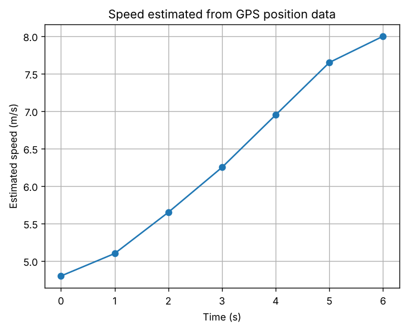
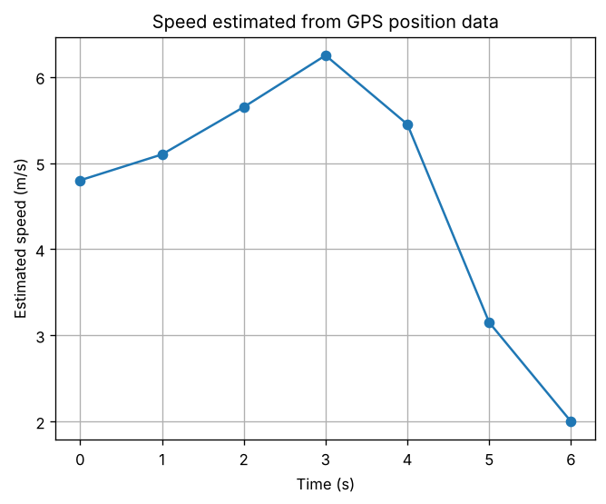
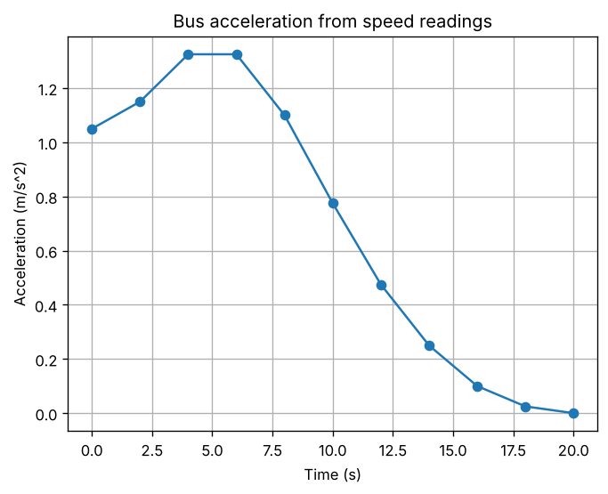

# Task 15: Numerical Differentiation

**Course:** BIT 2118 Scientific Computing  
**Student:** Michael Asilwa (Admission No: BSCCS/2024/56330, GitHub: xxplosi)  
**Files:** `code/Task_15_numerical_differentiation.py` (given program), `code/Task_15_numerical_differentiation_param_change.py` (changed parameter), `code/Task_15_modified.py` (my real-world case)

## 1. Inputs and mathematical operation

- **Input data:** GPS time stamps 0 to 6 s and positions [0, 4.8, 10.2, 16.1, 22.7, 30.0, 38.0] m.
- **Mathematical operations:** speed = change in position / change in time, using a forward difference at the first point, central differences f'(x) = [f(x+h) - f(x-h)]/(2h) at interior points, and a backward difference at the last point.

## 2. Original program and output

Run with `python code/Task_15_numerical_differentiation.py`.

```text
t=0s, position=0.0m, estimated speed=4.80m/s
t=1s, position=4.8m, estimated speed=5.10m/s
t=2s, position=10.2m, estimated speed=5.65m/s
t=3s, position=16.1m, estimated speed=6.25m/s
t=4s, position=22.7m, estimated speed=6.95m/s
t=5s, position=30.0m, estimated speed=7.65m/s
t=6s, position=38.0m, estimated speed=8.00m/s
```



## 3. Changing a parameter

**What I changed:** Changed the last two positions to 27.0 m and 29.0 m (the vehicle slows down).

```python
position = np.array([0.0, 4.8, 10.2, 16.1, 22.7, 27.0, 29.0])   # last two were 30.0, 38.0
```

**Output after the change** (`code/Task_15_numerical_differentiation_param_change.py`):

```text
t=0s, position=0.0m, estimated speed=4.80m/s
t=1s, position=4.8m, estimated speed=5.10m/s
t=2s, position=10.2m, estimated speed=5.65m/s
t=3s, position=16.1m, estimated speed=6.25m/s
t=4s, position=22.7m, estimated speed=5.45m/s
t=5s, position=27.0m, estimated speed=3.15m/s
t=6s, position=29.0m, estimated speed=2.00m/s
```



**How the result changed and why:** The estimated speed now rises to 6.25 m/s at t = 3 s and then falls to 5.45, 3.15 and 2.00 m/s, instead of increasing to 8.00 m/s. The graph changes from a rising line to a hump. This shows that the differences respond directly to how the position changes, and that the last point uses only a one-sided difference.

## 4. Meaning of the output

The estimated speed increases from 4.80 m/s at the start to 8.00 m/s at the end, so the vehicle is accelerating. For example at t = 1 s the central difference is (10.2 - 0)/2 = 5.10 m/s. The end points use one-sided differences, which are usually less accurate than the central differences in the middle.

## 5. Modified real-world case: Acceleration of a bus from speed readings

### Assumptions and input data

- Speed (m/s) recorded every 2 seconds as a bus leaves a stop and reaches cruising speed (synthetic data).
- Acceleration = rate of change of speed; compare the hand-written differences with `np.gradient`.

### Program (`code/Task_15_modified.py`)

```python
"""Task 15 (modified): Acceleration of a bus from speed readings.
Assumption: speed (m/s) logged every 2 seconds while a bus leaves a stop and cruises.
Estimate acceleration with forward/central/backward differences and np.gradient."""
import numpy as np
import matplotlib.pyplot as plt

t = np.arange(0, 22, 2, dtype=float)
v = np.array([0.0, 2.1, 4.6, 7.4, 9.9, 11.8, 13.0, 13.7, 14.0, 14.1, 14.1])

acc = np.zeros_like(v)
acc[0] = (v[1] - v[0]) / (t[1] - t[0])
acc[1:-1] = (v[2:] - v[:-2]) / (t[2:] - t[:-2])
acc[-1] = (v[-1] - v[-2]) / (t[-1] - t[-2])

check = np.gradient(v, t)
print("t (s) | speed (m/s) | acceleration (m/s^2)")
for ti, vi, ai in zip(t, v, acc):
    print(f"{ti:4.0f}  | {vi:6.1f}     | {ai:6.3f}")
print("Max difference vs np.gradient:", np.max(np.abs(acc - check)))
print(f"Peak acceleration: {acc.max():.3f} m/s^2 at t = {t[acc.argmax()]:.0f} s")

plt.plot(t, acc, marker="o")
plt.xlabel("Time (s)"); plt.ylabel("Acceleration (m/s^2)")
plt.title("Bus acceleration from speed readings"); plt.grid(True); plt.show()
```

### Output

```text
t (s) | speed (m/s) | acceleration (m/s^2)
   0  |    0.0     |  1.050
   2  |    2.1     |  1.150
   4  |    4.6     |  1.325
   6  |    7.4     |  1.325
   8  |    9.9     |  1.100
  10  |   11.8     |  0.775
  12  |   13.0     |  0.475
  14  |   13.7     |  0.250
  16  |   14.0     |  0.100
  18  |   14.1     |  0.025
  20  |   14.1     |  0.000
Max difference vs np.gradient: 0.0
Peak acceleration: 1.325 m/s^2 at t = 4 s
```



### Interpretation

The acceleration peaks at 1.325 m/s^2 at t = 4 to 6 s and then falls to 0 as the bus reaches a steady 14.1 m/s (about 50.8 km/h). My differences match `np.gradient` exactly (difference 0.0), which confirms the implementation. The graph shows the typical pattern: strong acceleration at first, then smaller and smaller as cruising speed is reached.

---
*Note: numbers marked as timings (Tasks 3 and 7) depend on the computer and change slightly from run to run. All other results are reproducible with the fixed random seeds in the code.*
