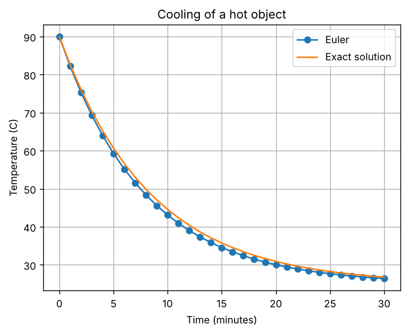
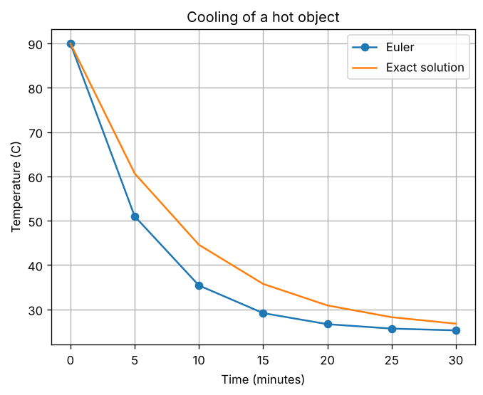
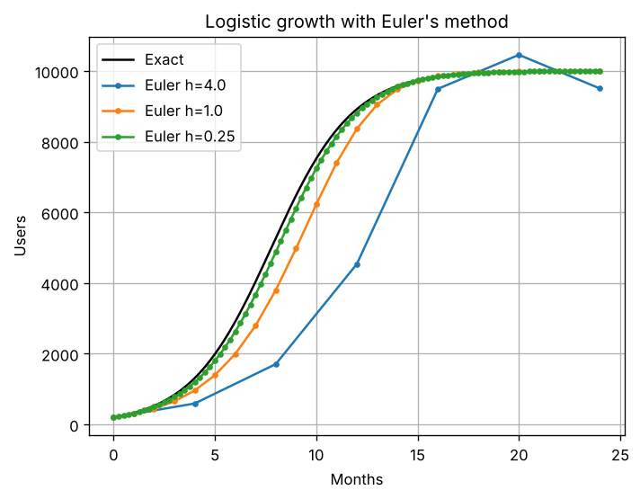

# Task 17: Ordinary Differential Equations: Euler Method

**Course:** BIT 2118 Scientific Computing  
**Student:** Michael Asilwa (Admission No: BSCCS/2024/56330, GitHub: xxplosi)  
**Files:** `code/Task_17_euler_ode.py` (given program), `code/Task_17_euler_ode_param_change.py` (changed parameter), `code/Task_17_modified.py` (my real-world case)

## 1. Inputs and mathematical operation

- **Input data:** ambient temperature 25 C, initial temperature 90 C, cooling constant k = 0.12 per minute, time step h = 1 minute, duration 30 minutes.
- **Mathematical operation:** Newton's law of cooling dT/dt = -k (T - T_ambient), solved with Euler's update T_(n+1) = T_n + h x (-k (T_n - T_ambient)), and compared with the exact solution T = 25 + 65 e^(-0.12 t).

## 2. Original program and output

Run with `python code/Task_17_euler_ode.py`.

```text
Euler temperature after 30 min: 26.40 C
Exact temperature after 30 min: 26.78 C
Final absolute error: 0.3720 C
```



## 3. Changing a parameter

**What I changed:** Increased the time step from 1 minute to 5 minutes.

```python
h = 5.0          # minutes (was 1.0)
```

**Output after the change** (`code/Task_17_euler_ode_param_change.py`):

```text
Euler temperature after 30 min: 25.27 C
Exact temperature after 30 min: 26.78 C
Final absolute error: 1.5098 C
```



**How the result changed and why:** The Euler result after 30 minutes changed from 26.40 C to 25.27 C, while the exact value is 26.78 C, so the final error grew from 0.372 C to 1.510 C. A five times larger step gave about four times the error, which is typical for Euler's first-order method: the error is roughly proportional to the step size. The graph has only 7 points and visibly deviates from the exact curve.

## 4. Meaning of the output

The object cools from 90 C towards the surrounding 25 C. After 30 minutes Euler gives 26.40 C and the exact solution gives 26.78 C, an error of 0.372 C. Euler is slightly low because it uses the slope at the start of each step, which is steeper than the average slope over the step. On the graph the Euler and exact curves lie almost on top of each other.

## 5. Modified real-world case: Logistic growth of an online community

### Assumptions and input data

- dP/dt = r P (1 - P/K) with growth rate r = 0.5 per month, capacity K = 10,000 users and 200 users at the start, simulated for 24 months.
- Three step sizes (4, 1 and 0.25 months) are compared with the exact logistic solution.

### Program (`code/Task_17_modified.py`)

```python
"""Task 17 (modified): Logistic population growth solved with Euler's method.
Assumption: a user community grows dP/dt = r*P*(1 - P/K) with r = 0.5 per month,
carrying capacity K = 10,000 users and P(0) = 200. Compare three step sizes."""
import numpy as np
import matplotlib.pyplot as plt

r, K, P0, T = 0.5, 10_000.0, 200.0, 24.0

def euler(h):
    t = np.arange(0, T + h, h)
    P = np.zeros_like(t); P[0] = P0
    for i in range(len(t) - 1):
        P[i + 1] = P[i] + h * r * P[i] * (1 - P[i] / K)
    return t, P

exact = lambda t: K / (1 + (K / P0 - 1) * np.exp(-r * t))

for h in (4.0, 1.0, 0.25):
    t, P = euler(h)
    print(f"h = {h:<5}: P(24) = {P[-1]:9.2f} | exact = {exact(24):9.2f} | max error = {np.max(np.abs(P-exact(t))):8.2f}")

tt = np.linspace(0, T, 300)
plt.plot(tt, exact(tt), "k", label="Exact")
for h in (4.0, 1.0, 0.25):
    t, P = euler(h); plt.plot(t, P, marker="o", markersize=3, label=f"Euler h={h}")
plt.xlabel("Months"); plt.ylabel("Users"); plt.title("Logistic growth with Euler's method")
plt.legend(); plt.grid(True); plt.show()
```

### Output

```text
h = 4.0  : P(24) =   9502.50 | exact =   9996.99 | max error =  4381.26
h = 1.0  : P(24) =   9999.43 | exact =   9996.99 | max error =  1500.52
h = 0.25 : P(24) =   9997.74 | exact =   9996.99 | max error =   394.18
```



### Interpretation

The community grows slowly at first, speeds up in the middle and levels off near the capacity of 10,000 (an S-shaped curve). The largest error during the simulation is 4,381 users for h = 4, 1,501 for h = 1 and 394 for h = 0.25, so a smaller step size reduces the error. The errors are biggest during the steep middle phase, because that is where the slope changes fastest. The final values (9,503, 9,999 and 9,998) are all near the capacity of 10,000, yet the mid-course errors are large, so it is better to compare the whole curve than only the last value.

---
*Note: numbers marked as timings (Tasks 3 and 7) depend on the computer and change slightly from run to run. All other results are reproducible with the fixed random seeds in the code.*
