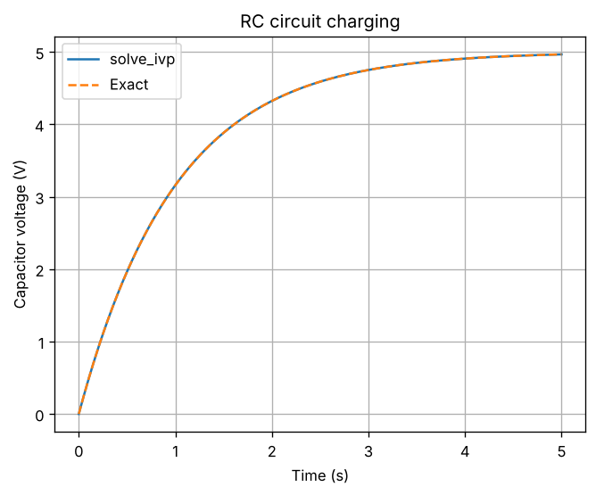
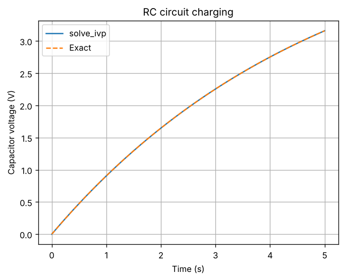
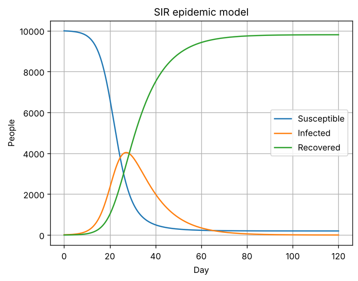

# Task 18: Numerical Solution of ODEs Using SciPy

**Course:** BIT 2118 Scientific Computing  
**Student:** Michael Asilwa (Admission No: BSCCS/2024/56330, GitHub: xxplosi)  
**Files:** `code/Task_18_scipy_ode.py` (given program), `code/Task_18_scipy_ode_param_change.py` (changed parameter), `code/Task_18_modified.py` (my real-world case)

## 1. Inputs and mathematical operation

- **Input data:** supply voltage 5 V, resistance 1000 ohm, capacitance 0.001 F (so the time constant RC = 1 s), initial capacitor voltage 0 V, time from 0 to 5 s.
- **Mathematical operation:** solve dV/dt = (Vs - V)/(RC) with `solve_ivp` (adaptive step size, tight tolerances) and compare with the exact curve V = Vs (1 - e^(-t/RC)).

## 2. Original program and output

Run with `python code/Task_18_scipy_ode.py`.

```text
Solver success: True
Capacitor voltage at 5 s: 4.9663 V
Maximum error against exact solution: 9.282e-10 V
```



## 3. Changing a parameter

**What I changed:** Increased the capacitance from 0.001 F to 0.005 F.

```python
C = 0.005       # capacitance (was 0.001)
```

**Output after the change** (`code/Task_18_scipy_ode_param_change.py`):

```text
Solver success: True
Capacitor voltage at 5 s: 3.1606 V
Maximum error against exact solution: 4.417e-10 V
```



**How the result changed and why:** The time constant became RC = 5 s, so the capacitor charges more slowly: the voltage at 5 s dropped from 4.9663 V to 3.1606 V, which is 63.2% of 5 V (one time constant). The solver error stayed tiny (4.4e-10 V). A bigger capacitor stores more charge and takes longer to fill.

## 4. Meaning of the output

The solver reports success and the capacitor voltage reaches 4.9663 V after 5 s, which is 99.3% of the 5 V supply (five time constants). The maximum difference from the exact formula is about 9.3e-10 V, so the numerical solution is extremely accurate. On the graph the solver curve and the dashed exact curve cannot be told apart: the voltage rises quickly at first and then levels off at 5 V.

## 5. Modified real-world case: SIR epidemic model

### Assumptions and input data

- Population of 10,000 with 10 people initially infected, infection rate beta = 0.4 per day and recovery rate gamma = 0.1 per day, so R0 = beta/gamma = 4.
- Three coupled equations for Susceptible, Infected and Recovered people, simulated for 120 days. This is a simple teaching model and not a forecast of any real disease.

### Program (`code/Task_18_modified.py`)

```python
"""Task 18 (modified): SIR epidemic model solved with solve_ivp.
Assumption: population 10,000, 10 initially infected, infection rate beta = 0.4/day,
recovery rate gamma = 0.1/day (so R0 = beta/gamma = 4). Simulate 120 days."""
import numpy as np
from scipy.integrate import solve_ivp
import matplotlib.pyplot as plt

N, beta, gamma = 10_000.0, 0.4, 0.1

def sir(t, y):
    S, I, R = y
    return [-beta * S * I / N, beta * S * I / N - gamma * I, gamma * I]

sol = solve_ivp(sir, (0, 120), [N - 10, 10, 0], t_eval=np.linspace(0, 120, 481), rtol=1e-8, atol=1e-8)
S, I, R = sol.y
peak = I.argmax()

print("Solver success:", sol.success)
print(f"R0 = beta/gamma = {beta/gamma:.1f}")
print(f"Peak infections: {I[peak]:.0f} people on day {sol.t[peak]:.1f}")
print(f"Total ever infected by day 120: {R[-1] + I[-1]:.0f} ({(R[-1]+I[-1])/N:.1%})")
print(f"Population conserved? S+I+R at end = {S[-1]+I[-1]+R[-1]:.4f}")

plt.plot(sol.t, S, label="Susceptible"); plt.plot(sol.t, I, label="Infected"); plt.plot(sol.t, R, label="Recovered")
plt.xlabel("Day"); plt.ylabel("People"); plt.title("SIR epidemic model")
plt.legend(); plt.grid(True); plt.show()
```

### Output

```text
Solver success: True
R0 = beta/gamma = 4.0
Peak infections: 4036 people on day 27.2
Total ever infected by day 120: 9802 (98.0%)
Population conserved? S+I+R at end = 10000.0000
```



### Interpretation

Infections peak at about 4,036 people on day 27, then fall as fewer susceptible people remain. By day 120 about 9,802 people (98%) have been infected at some point. The total S + I + R stays at 10,000, which confirms the equations conserve the population. With R0 = 4 the epidemic infects almost everyone; lowering the infection rate beta (for example by distancing) would lower and delay the peak.

---
*Note: numbers marked as timings (Tasks 3 and 7) depend on the computer and change slightly from run to run. All other results are reproducible with the fixed random seeds in the code.*
