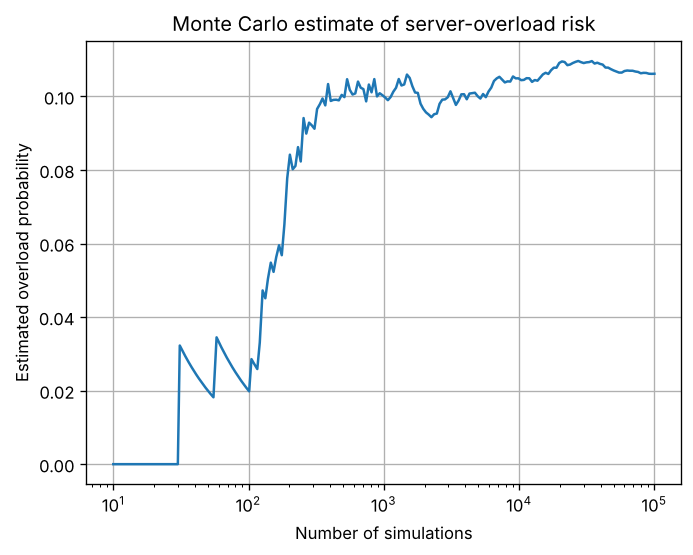
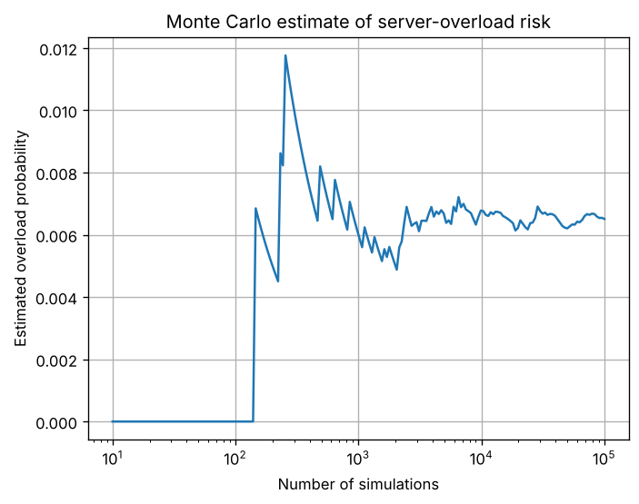
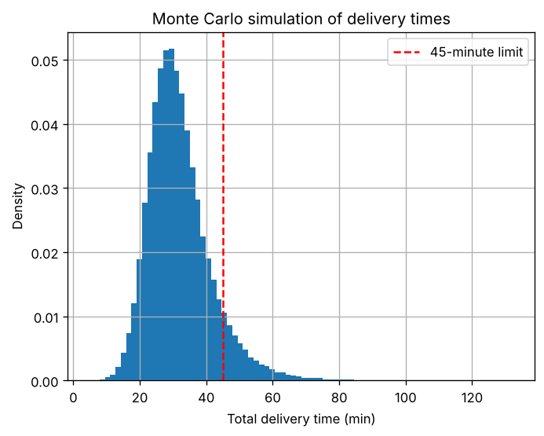

# Task 20: Random Numbers and Monte Carlo Methods

**Course:** BIT 2118 Scientific Computing  
**Student:** Michael Asilwa (Admission No: BSCCS/2024/56330, GitHub: xxplosi)  
**Files:** `code/Task_20_monte_carlo.py` (given program), `code/Task_20_monte_carlo_param_change.py` (changed parameter), `code/Task_20_modified.py` (my real-world case)

## 1. Inputs and mathematical operation

- **Input data:** server capacity 1000, demand ~ Normal(mean 850, standard deviation 120), 100,000 simulations, random seed 42.
- **Mathematical operation:** generate random demand scenarios, count how many exceed capacity, and estimate the overload probability as (overloaded cases)/(total cases). A running estimate shows convergence.

## 2. Original program and output

Run with `python code/Task_20_monte_carlo.py`.

```text
Estimated overload probability: 10.6160%
Number of overload cases: 10616 out of 100000
```



## 3. Changing a parameter

**What I changed:** Reduced the demand standard deviation from 120 to 60.

```python
std_demand = 60.0   # was 120.0
```

**Output after the change** (`code/Task_20_monte_carlo_param_change.py`):

```text
Estimated overload probability: 0.6510%
Number of overload cases: 651 out of 100000
```



**How the result changed and why:** The estimated overload probability fell from 10.62% to 0.65% (651 cases out of 100,000). With less variation in demand, it is much rarer for demand to climb all the way from 850 to 1000. Theory agrees: capacity is 1.25 standard deviations above the mean originally (about 10.6%) and 2.5 standard deviations after the change (about 0.62%).

## 4. Meaning of the output

About 10.6% of the simulated scenarios exceed the capacity (10,616 of 100,000), roughly one in ten. The convergence graph shows the estimate bouncing around when only a few simulations are used and settling near 10.6% as the number of simulations grows. The exact normal-distribution value is 10.56%, so the simulation is close.

## 5. Modified real-world case: Will a delivery take longer than 45 minutes?

### Assumptions and input data

- Total time = waiting for pickup (exponential, mean 8 min) + riding (normal, mean 20 min, standard deviation 5) + handover (uniform 2 to 6 min). These distributions are assumptions.
- 200,000 simulated deliveries, seed 2026.

### Program (`code/Task_20_modified.py`)

```python
"""Task 20 (modified): Will a delivery take longer than 45 minutes?
Assumption (synthetic): waiting for pickup ~ Exponential(mean 8 min); riding time
~ Normal(mean 20, sd 5); handover ~ Uniform(2, 6) minutes. Simulate 200,000 deliveries."""
import numpy as np
import matplotlib.pyplot as plt

rng = np.random.default_rng(2026)
N = 200_000
wait = rng.exponential(8.0, N)
ride = np.clip(rng.normal(20.0, 5.0, N), 0, None)
handover = rng.uniform(2.0, 6.0, N)
total = wait + ride + handover

late = total > 45
p = late.mean()
se = np.sqrt(p * (1 - p) / N)

print(f"Mean delivery time: {total.mean():.2f} min | median: {np.median(total):.2f} min")
print(f"90th percentile: {np.percentile(total, 90):.2f} min")
print(f"P(delivery > 45 min): {p:.4%}  (standard error about {se:.4%})")
print(f"Late deliveries: {late.sum()} of {N}")

plt.hist(total, bins=80, density=True)
plt.axvline(45, color="r", linestyle="--", label="45-minute limit")
plt.xlabel("Total delivery time (min)"); plt.ylabel("Density")
plt.title("Monte Carlo simulation of delivery times"); plt.legend(); plt.grid(True); plt.show()
```

### Output

```text
Mean delivery time: 31.96 min | median: 30.51 min
90th percentile: 43.98 min
P(delivery > 45 min): 8.7975%  (standard error about 0.0633%)
Late deliveries: 17595 of 200000
```



### Interpretation

The mean delivery time is 31.96 minutes and the median is 30.51, so the distribution is skewed to the right (a few long waits). The 90th percentile is about 44 minutes and the chance of exceeding 45 minutes is 8.80% (17,595 of 200,000 deliveries), with a standard error of about 0.06%. The histogram shows the long right tail beyond the red 45-minute line. Since waiting for pickup creates the long tail, reducing pickup waiting would reduce late deliveries the most.

---
*Note: numbers marked as timings (Tasks 3 and 7) depend on the computer and change slightly from run to run. All other results are reproducible with the fixed random seeds in the code.*
